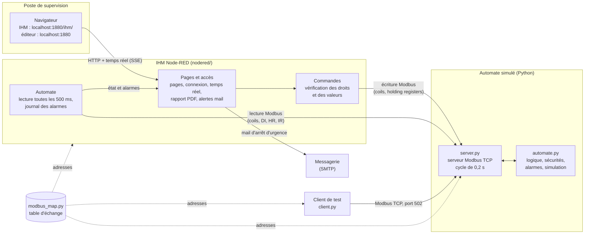
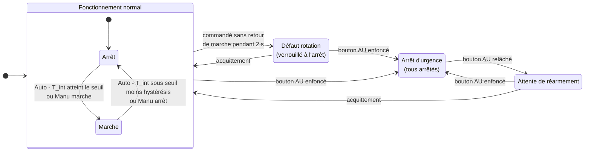
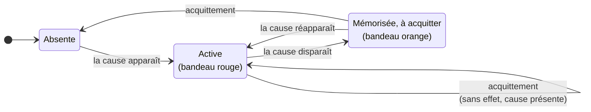
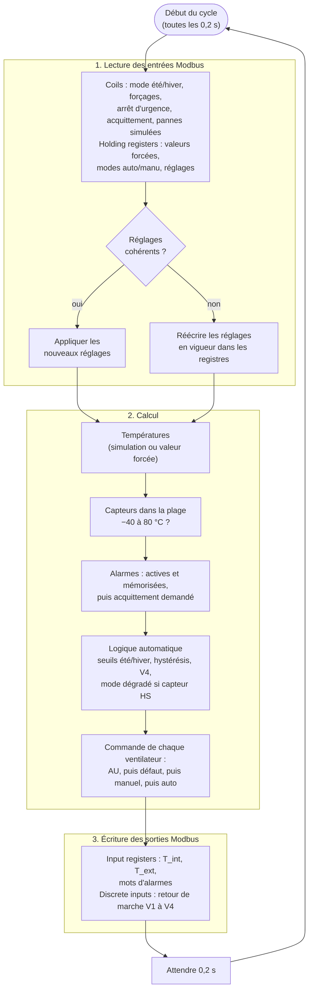

# Ventilation Modbus

📋 **[Table d'échange Modbus](TABLE_MODBUS.md)**

Simulation d'un **automate programmable (API)** qui pilote la ventilation d'un
bâtiment, avec une **IHM web** de supervision construite avec **Node-RED**.

L'automate lit deux capteurs de température (intérieur et extérieur), commande
4 ventilateurs selon une logique été / hiver, gère un mode **auto / manuel**,
des **sécurités** (arrêt d'urgence, contrôle de rotation, défauts capteurs) et
des **alarmes** à acquitter. Il expose toutes ses données en **Modbus TCP**,
comme un vrai automate industriel. L'IHM et le client de test
ne communiquent avec lui que par Modbus.

## Architecture



L'automate et ses clients ne se parlent **que par Modbus TCP** (port 502,
esclave 1). Toutes les adresses viennent d'un seul fichier,
[`modbus_map.py`](src/ventilation_modbus/modbus_map.py) : voir la
[table d'échange Modbus](TABLE_MODBUS.md).

## Fonctionnement de l'automate

### Les capteurs

| Capteur | Rôle |
|---|---|
| **T_int** | Température intérieure du bâtiment |
| **T_ext** | Température extérieure |

### Les ventilateurs

V1, V2 et V3 **extraient** l'air chaud du bâtiment. **V4 est monté à l'envers** :
il **insuffle** l'air extérieur dans le bâtiment, ce qui n'a d'intérêt que si
l'air du dehors est plus frais que celui du dedans.

Réglages par défaut (tous modifiables depuis l'IHM, voir
[Réglage des seuils](#réglage-des-seuils)) :

| Ventilateur | Mode été | Mode hiver |
|---|---|---|
| V1 | T_int ≥ 23 °C | T_int ≥ 26 °C |
| V2 | T_int ≥ 24 °C | T_int ≥ 27 °C |
| V3 | T_int ≥ 25 °C | T_int ≥ 28 °C |
| V4 (insufflation) | T_int > T_ext | T_int > T_ext **et** T_int > 28 °C |

En hiver, une **boucle thermohydraulique** chauffe le bâtiment : les seuils
sont plus hauts pour profiter de cette chaleur avant de ventiler, et V4
ne fait entrer l'air froid extérieur que si l'intérieur dépasse 28 °C.

**Hystérésis de 0,5 °C** (par défaut) : un ventilateur s'arrête 0,5 °C sous son seuil de
démarrage (par exemple V1 démarre à 23 °C et s'arrête sous 22,5 °C). Cela évite
qu'il s'allume et s'éteigne en permanence quand la température oscille autour
du seuil.

### La simulation

Le programme simule aussi la physique du bâtiment, en **temps accéléré** (une
journée dure 10 minutes) :

- **Extérieur** : cycle jour/nuit, entre 18 et 30 °C en été, entre 0 et 10 °C en hiver.
- **Intérieur** : le bâtiment se réchauffe (soleil, occupants et, en hiver, la
  boucle de chauffage). Les échanges par les murs et chaque ventilateur en
  marche rapprochent la température intérieure de la température extérieure.

Pour les tests, les deux températures peuvent être **forcées** à une valeur
choisie depuis l'IHM, et une **panne moteur** peut être simulée sur chaque
ventilateur (il ne tourne plus, même commandé).

### Mode auto / manuel

Chaque ventilateur a son propre mode de conduite, choisi depuis l'IHM :

| Mode | Comportement |
|---|---|
| **Auto** | piloté par la logique été / hiver ci-dessus |
| **Marche** (manuel) | marche forcée par l'opérateur |
| **Arrêt** (manuel) | arrêt forcé par l'opérateur |

La logique automatique continue de tourner en arrière-plan : en revenant en
auto, le ventilateur reprend l'état calculé, hystérésis comprise.

### Sécurités

Elles s'appliquent par ordre de priorité, la première l'emportant sur toutes
les autres, **mode manuel compris** :

1. **Arrêt d'urgence (AU)** : tous les ventilateurs s'arrêtent. Quand on
   relâche le bouton, **rien ne redémarre** tant que l'opérateur n'a pas
   acquitté (réarmement), pour qu'une machine ne reparte jamais toute seule.
2. **Contrôle de rotation** : si un ventilateur est commandé mais qu'aucun
   retour de marche n'arrive pendant **2 s**, il passe en défaut et reste
   verrouillé à l'arrêt jusqu'à l'acquittement.
3. **Mode manuel**, puis **logique automatique**.

**Mode dégradé** : un capteur qui mesure hors de sa plage (−40 à 80 °C) est
considéré en défaut (câble coupé, sonde HS) :

- sans T_int, l'automate ne peut plus appliquer ses seuils : seul **V1** tourne,
  pour garder un renouvellement d'air minimal ;
- sans T_ext, la comparaison intérieur / extérieur est impossible : **V4**
  s'arrête.

### Alarmes

| Alarme | Cause |
|---|---|
| Arrêt d'urgence | bouton AU enfoncé |
| Température intérieure haute | T_int ≥ 35 °C (hystérésis 0,5 °C) |
| Défaut capteur T_int / T_ext | mesure hors de la plage −40 à 80 °C |
| Défaut rotation V1 à V4 | commandé sans retour de marche pendant 2 s |

Chaque alarme est **mémorisée** dès que sa cause apparaît. L'**acquittement**
efface les alarmes mémorisées dont la cause a disparu ; une alarme dont la
cause est toujours présente reste affichée. L'IHM montre un bandeau (rouge :
alarme active, orange : en attente d'acquittement), l'état de chaque alarme et
un **journal horodaté** (apparition, disparition, acquittement).

### Diagrammes d'états

**Un ventilateur** (le même schéma vaut pour V1, V2, V3 et V4) :



Priorités : arrêt d'urgence, puis défaut de rotation, puis mode manuel, puis
logique automatique. En sortant d'un défaut ou d'un arrêt d'urgence, le
ventilateur ne repart **qu'après l'acquittement** de l'opérateur.

**Une alarme** (couleurs du bandeau de l'IHM) :



### Cycle automate

Comme un vrai API, le programme tourne en boucle toutes les **0,2 s** :

1. lecture des entrées Modbus (mode été/hiver, forçages, modes auto/manu,
   arrêt d'urgence, acquittement) ;
2. calcul : températures, alarmes, logique automatique, puis commande des
   ventilateurs après modes et sécurités ;
3. écriture des sorties Modbus (températures, mots d'alarmes, état des
   ventilateurs).



## Accès opérateur / administrateur

Tout le monde peut **consulter** l'IHM. Les commandes demandent de se connecter
(bouton **Se connecter** en haut de la page), avec un niveau d'accès minimal :

| Commande | Sans connexion | Opérateur | Administrateur |
|---|:---:|:---:|:---:|
| Consulter températures, ventilateurs, alarmes, journal | ✓ | ✓ | ✓ |
| Arrêt d'urgence (enfoncer / relâcher) | ✓ | ✓ | ✓ |
| Acquitter les alarmes (réarmement) | | ✓ | ✓ |
| Mode été / hiver, modes auto / marche / arrêt | | ✓ | ✓ |
| Exporter le rapport d'alarmes en PDF | | ✓ | ✓ |
| Régler les seuils, l'hystérésis et l'alarme haute | | | ✓ |
| Gérer les destinataires des alertes par mail | | | ✓ |
| Forcer les températures, simuler des pannes (tests) | | | ✓ |

L'**arrêt d'urgence** reste accessible sans connexion : une sécurité ne doit
jamais être bloquée par un mot de passe. Le relâcher ne relance rien, puisque
le réarmement passe par l'acquittement, réservé aux utilisateurs connectés.

Comptes par défaut :

| Identifiant | Mot de passe | Niveau |
|---|---|---|
| `operateur` | `operateur` | opérateur |
| `admin` | `admin` | administrateur |

Pour changer les mots de passe, lancer l'IHM (depuis le dossier `nodered`) avec des
variables d'environnement. Sous macOS et Linux :

```bash
IHM_OPERATOR_PASSWORD=monmotdepasse IHM_ADMIN_PASSWORD=autremotdepasse npm start
```

Sous Windows (PowerShell) :

```powershell
$env:IHM_OPERATOR_PASSWORD="monmotdepasse"; $env:IHM_ADMIN_PASSWORD="autremotdepasse"; npm.cmd start
```

Node-RED vérifie lui-même le niveau d'accès de chaque commande : les
boutons grisés sur la page ne sont qu'une aide visuelle. Une session dure 8 h
et se perd au redémarrage de l'IHM. Chaque action (connexion, acquittement,
changement de mode, forçage…) est inscrite dans le journal avec le nom de
l'utilisateur, ou « non connecté » pour l'arrêt d'urgence.

Comme sur une vraie installation, la protection porte sur l'IHM : le protocole
Modbus n'a pas d'authentification, et `client.py` parle directement à
l'automate.

## Réglage des seuils

La carte **Réglages des seuils** de l'IHM, réservée à l'administrateur, permet
de modifier en fonctionnement :

- les seuils de démarrage de V1, V2 et V3, en été et en hiver ;
- le seuil au-dessus duquel V4 insuffle l'air extérieur en hiver ;
- l'hystérésis ;
- le seuil de l'alarme température haute.

Les nouvelles valeurs sont écrites dans les holding registers 6 à 14 de
l'automate, qui les applique au cycle suivant. Les seuils affichés sur les
ventilateurs et la graduation de T_int suivent automatiquement.

Comme un vrai automate, il **refuse un réglage incohérent** et garde alors les
réglages en vigueur :

- températures entre 0 et 60 °C ;
- seuils croissants dans chaque saison (V1 ≤ V2 ≤ V3) ;
- hystérésis entre 0,1 et 5 °C.

Le bouton **Valeurs par défaut** remet tous ces réglages à leur valeur
d'origine, après confirmation. L'IHM envoie pour cela une commande à
l'automate (coil 9), qui est seul à connaître les valeurs par défaut.

L'IHM vérifie les mêmes règles pour afficher un message clair. Chaque
modification est inscrite dans le journal, avec l'ancienne et la nouvelle
valeur, et les réglages en vigueur figurent dans le rapport PDF.

Les réglages sont conservés tant que l'automate tourne. Ils reviennent aux
valeurs par défaut quand on le redémarre, et `client.py` les remet aussi par
défaut au début et à la fin de son test.

## Rapport d'alarmes en PDF

Le bouton **Exporter en PDF**, au-dessus du journal, télécharge un rapport
`rapport-alarmes_<date>.pdf` qui contient :

- la date de l'export, l'utilisateur qui l'a demandé et la période couverte
  (depuis le démarrage de l'IHM) ;
- l'état de l'installation à ce moment : mode, températures, arrêt d'urgence,
  marche et mode de chaque ventilateur ;
- les réglages en vigueur (seuils, hystérésis, alarme haute) ;
- l'état actuel de chaque alarme et son nombre d'apparitions sur la période ;
- le journal complet dans l'ordre chronologique : alarmes et actions des
  utilisateurs.

L'IHM garde en mémoire les 500 derniers événements, remis à zéro à chaque
redémarrage de l'IHM.

## Alertes par mail

À chaque **arrêt d'urgence**, l'IHM envoie un mail d'alerte à une liste
d'adresses : date et heure, origine (depuis l'IHM et par quel utilisateur, ou
depuis l'extérieur : commande Modbus directe, bouton physique), mode et
températures. Le mail part dès que l'alarme apparaît, quelle que soit la façon
dont l'arrêt d'urgence a été déclenché.

Tout se règle depuis l'IHM, sans aucun fichier à modifier : le bouton
**Alertes mail**, en haut de la page de supervision, ouvre une fenêtre dédiée.
Elle est réservée à l'administrateur : sans connexion ou en opérateur, un
message l'indique et propose de se connecter. La fenêtre comporte deux parties :

1. **Compte d'envoi** (une seule fois) : l'adresse qui enverra les alertes et
   son mot de passe d'application. Le serveur de messagerie est déduit de
   l'adresse (Gmail, Outlook / Hotmail, iCloud, Yahoo, Orange, Free). Pour une
   autre messagerie, renseigner son serveur SMTP. L'IHM vérifie tout de suite
   les identifiants auprès du serveur avant de les enregistrer.
2. **Destinataires** : ajouter ou retirer des adresses, puis vérifier avec
   **Envoyer un mail de test**.

Un compte d'envoi est indispensable : les messageries refusent ou classent en
spam les mails qui ne viennent pas d'un compte authentifié, et les services
gratuits d'envoi anonyme ont été fermés à cause des abus.

Avec **Gmail**, le mot de passe demandé n'est pas celui du compte, mais un
**mot de passe d'application**. Il faut d'abord activer la validation en deux
étapes du compte Google, puis le créer sur
[myaccount.google.com/apppasswords](https://myaccount.google.com/apppasswords)
et le coller dans l'IHM.

Le compte d'envoi et la liste des destinataires sont enregistrés dans
`nodered/data/` : ils sont **conservés quand on redémarre l'IHM**. Ce dossier
(qui contient un mot de passe) n'est **pas envoyé sur GitHub**, car il est
exclu par `.gitignore`. Il reste propre à chaque ordinateur et à chaque copie
du projet. Le mot de passe n'est jamais renvoyé à la page. Les destinataires
sont en copie cachée, et chacun ne voit pas les adresses des autres. Chaque
envoi, réussi ou non, est inscrit dans le journal.

À noter : `client.py` déclenche lui aussi des arrêts d'urgence pendant son
test. Si l'envoi est configuré, chaque test envoie donc des mails d'alerte.

## Table d'échange Modbus

Cette table existe aussi seule, dans [`TABLE_MODBUS.md`](TABLE_MODBUS.md).

Automate : unit id **1**, port **502**. Toutes les adresses sont définies à un
seul endroit, [`modbus_map.py`](src/ventilation_modbus/modbus_map.py), que l'automate,
le client et l'IHM utilisent tous.

| Type | Adresse | Accès | Signification |
|---|---|---|---|
| Coil | 0 | lecture/écriture | Mode : 1 = été, 0 = hiver |
| Coil | 1 | lecture/écriture | Forçage de T_int actif |
| Coil | 2 | lecture/écriture | Forçage de T_ext actif |
| Coil | 3 | lecture/écriture | Arrêt d'urgence enfoncé |
| Coil | 4 | lecture/écriture | Acquittement : écrire 1, l'automate le remet à 0 |
| Coil | 5 à 8 | lecture/écriture | Panne moteur simulée de V1 à V4 (tests) |
| Coil | 9 | lecture/écriture | Retour aux réglages par défaut : écrire 1, l'automate le remet à 0 |
| Holding register | 0 | lecture/écriture | Valeur forcée de T_int |
| Holding register | 1 | lecture/écriture | Valeur forcée de T_ext |
| Holding register | 2 à 5 | lecture/écriture | Mode de V1 à V4 : 0 = auto, 1 = marche, 2 = arrêt |
| Holding register | 6 à 8 | lecture/écriture | Seuils de démarrage V1 à V3 en été |
| Holding register | 9 à 11 | lecture/écriture | Seuils de démarrage V1 à V3 en hiver |
| Holding register | 12 | lecture/écriture | Seuil d'insufflation V4 en hiver |
| Holding register | 13 | lecture/écriture | Hystérésis |
| Holding register | 14 | lecture/écriture | Seuil de l'alarme température haute |
| Discrete input | 0 à 3 | lecture seule | Retour de marche de V1 à V4 |
| Input register | 0 | lecture seule | T_int |
| Input register | 1 | lecture seule | T_ext |
| Input register | 2 | lecture seule | Mot d'alarmes actives |
| Input register | 3 | lecture seule | Mot d'alarmes mémorisées (à acquitter) |

Les températures, seuils et hystérésis sont transmis en **dixièmes de degré**,
en entier signé 16 bits pour accepter les valeurs négatives (23,4 °C → 234).
Les réglages (registres 6 à 14) s'écrivent **en une seule requête** (FC16),
puisque l'automate vérifie la cohérence de l'ensemble.

Dans les **mots d'alarmes**, chaque bit correspond à une alarme : bit 0 arrêt
d'urgence, bit 1 température haute, bit 2 défaut capteur T_int, bit 3 défaut
capteur T_ext, bits 4 à 7 défaut rotation V1 à V4. Par exemple, un mot qui vaut
`0x21` signale l'arrêt d'urgence et un défaut de rotation sur V2.

## Structure du projet

```
├── src/ventilation_modbus/   # le paquet Python de l'automate
│   ├── modbus_map.py         # table d'échange Modbus (adresses, échelle, plages)
│   └── automate.py           # logique, modes, sécurités, alarmes, réglages, simulation
├── server.py                 # l'automate : serveur Modbus TCP + cycle de 0,2 s
├── client.py                 # test automatique (seuils, conduite, sécurités, réglages)
├── TABLE_MODBUS.md           # la table d'échange Modbus, seule
├── start.sh                  # lance tout en une commande sous macOS / Linux
├── start.bat, start.ps1      # lance tout en une commande sous Windows
├── nodered/                  # l'IHM, servie par Node-RED
│   ├── flows.json            # les flux : Modbus, commandes, pages, accès, journal
│   ├── fonctions/            # le code des blocs « function » des flux
│   ├── build-flows.js        # régénère flows.json à partir de fonctions/ et modbus_map.py
│   ├── settings.js           # réglages de Node-RED (port 1880, IHM sous /ihm/, accès local)
│   ├── modbus_map.js         # relit les adresses dans modbus_map.py
│   ├── report.js             # rapport d'alarmes en PDF
│   ├── alerts.js             # alertes par mail : compte d'envoi, destinataires, envoi
│   ├── public/
│   │   ├── index.html        # la page de supervision
│   │   ├── alertes.html      # la fenêtre de configuration des alertes par mail
│   │   └── common.css        # le style commun aux deux pages
│   └── data/                 # données locales (compte d'envoi, destinataires), non versionnées
└── pyproject.toml, uv.lock, nodered/package.json   # dépendances
```

Technologies : **Python 3.13** avec [uv](https://docs.astral.sh/uv/) et
[pymodbus](https://pymodbus.readthedocs.io/) 3.15 pour l'automate ;
**Node.js** avec [Node-RED](https://nodered.org/) 5,
[node-red-contrib-modbus](https://flows.nodered.org/node/node-red-contrib-modbus),
[Dashboard 2.0](https://dashboard.flowfuse.com/), [PDFKit](https://pdfkit.org/)
et [Nodemailer](https://nodemailer.com/) pour l'IHM.

## Tester le projet

Le projet se lance de deux façons, au choix, qui font exactement la même chose :

- **option A** : tout en une commande, avec un script de lancement ;
- **option B** : étape par étape, en copiant-collant les commandes une par une.

Suivez la partie correspondant à votre système : [macOS](#macos-et-linux)
ou [Windows](#windows).

### Prérequis

À installer une seule fois :

| Outil | macOS | Windows |
|---|---|---|
| [Git](https://git-scm.com/downloads) | taper `git --version` dans le Terminal, macOS propose de l'installer | installer [Git for Windows](https://git-scm.com/download/win) |
| [uv](https://docs.astral.sh/uv/getting-started/installation/) (Python) | `curl -LsSf https://astral.sh/uv/install.sh \| sh` | `powershell -ExecutionPolicy ByPass -c "irm https://astral.sh/uv/install.ps1 \| iex"` |
| [Node.js](https://nodejs.org/) | installeur « LTS » du site | installeur « LTS » du site |

Après ces installations, **fermez puis rouvrez** le terminal pour qu'il trouve
les nouvelles commandes. uv télécharge lui-même la bonne version de Python.

### macOS (et Linux)

Les commandes se tapent dans l'app **Terminal** (Cmd+Espace, puis « Terminal »).
Le projet est installé dans le dossier personnel : `~/ventilation-modbus`.

**1. Télécharger le projet** (la première fois seulement) :

```bash
cd ~ && git clone https://github.com/chloeturcan1/ventilation-modbus.git
```

`git clone` crée le dossier `ventilation-modbus`. Une seconde fois, elle répond
`destination path 'ventilation-modbus' already exists` : le projet est déjà
téléchargé, il suffit de passer à l'option A ou B.

#### Option A — En une commande (macOS)

```bash
cd ~/ventilation-modbus && ./start.sh
```

Le script [`start.sh`](start.sh) arrête une version déjà lancée, récupère la
dernière version (`git pull`), installe les dépendances, lance l'automate et
l'IHM, puis ouvre la page dans le navigateur. Les messages des deux programmes
s'affichent dans le même onglet, précédés de `[automate]` ou `[ihm]`.
**Ctrl+C** arrête tout.

Pour lancer en plus le test automatique : `./start.sh --test`.

#### Option B — Étape par étape (macOS)

**2. Arrêter une version déjà lancée, mettre à jour et installer :**

```bash
lsof -ti tcp:502,1880 | xargs kill
```

```bash
cd ~/ventilation-modbus && git pull && uv sync && cd nodered && npm install && cd ..
```

**3. Lancer l'automate** (onglet à laisser ouvert) :

```bash
cd ~/ventilation-modbus && uv run server.py
```

**4. Lancer l'IHM** (nouvel onglet avec **Cmd+T**, à laisser ouvert) :

```bash
cd ~/ventilation-modbus/nodered && npm start
```

Puis ouvrir **http://localhost:1880/ihm/** et recharger la page avec **Cmd+Shift+R**.

**5. Test automatique** (facultatif, nouvel onglet avec **Cmd+T**) :

```bash
cd ~/ventilation-modbus && uv run client.py
```

Pour tout arrêter : **Ctrl+C** (la touche Control, pas Cmd) dans chaque onglet.

### Windows

Les commandes se tapent dans **PowerShell** (touche Windows, puis
« PowerShell »). Le projet est installé dans le dossier personnel :
`C:\Users\<nom>\ventilation-modbus`, noté `~\ventilation-modbus` ci-dessous.

**1. Télécharger le projet** (la première fois seulement) :

```powershell
cd ~; git clone https://github.com/chloeturcan1/ventilation-modbus.git
```

Une seconde fois, `git clone` répond `destination path 'ventilation-modbus'
already exists` : le projet est déjà téléchargé, il suffit de passer à
l'option A ou B.

#### Option A — En une commande (Windows)

```powershell
cd ~\ventilation-modbus; .\start.bat
```

On peut aussi **double-cliquer sur `start.bat`** dans l'Explorateur de
fichiers. Le script arrête une version déjà lancée, récupère la dernière
version (`git pull`), installe les dépendances, ouvre **deux fenêtres**,
« Automate » et « IHM », puis ouvre la page dans le navigateur. Pour tout
arrêter, fermez ces deux fenêtres.

Pour lancer en plus le test automatique : `.\start.bat -Test`.

`start.bat` appelle [`start.ps1`](start.ps1) sans modifier la politique
d'exécution des scripts de Windows.

#### Option B — Étape par étape (Windows)

**2. Arrêter une version déjà lancée, mettre à jour et installer :**

```powershell
Get-NetTCPConnection -LocalPort 502,1880 -State Listen -ErrorAction SilentlyContinue | ForEach-Object { Stop-Process -Id $_.OwningProcess -Force }
```

```powershell
cd ~\ventilation-modbus; git pull; uv sync; cd nodered; npm.cmd install; cd ..
```

**3. Lancer l'automate** (fenêtre à laisser ouverte) :

```powershell
cd ~\ventilation-modbus; uv run server.py
```

Si le pare-feu Windows demande d'autoriser Python, vous pouvez accepter ou
annuler : l'automate et l'IHM communiquent sur l'ordinateur lui-même, ce que
le pare-feu ne bloque pas.

**4. Lancer l'IHM** (nouvelle fenêtre PowerShell, à laisser ouverte) :

```powershell
cd ~\ventilation-modbus\nodered; npm.cmd start
```

Puis ouvrir **http://localhost:1880/ihm/** et recharger la page avec **Ctrl+F5**.

**5. Test automatique** (facultatif, nouvelle fenêtre PowerShell) :

```powershell
cd ~\ventilation-modbus; uv run client.py
```

Pour tout arrêter : **Ctrl+C** dans chaque fenêtre.

On écrit `npm.cmd` plutôt que `npm` : sur beaucoup de postes Windows,
PowerShell bloque le script `npm.ps1` (« l'exécution de scripts est
désactivée sur ce système »), alors que `npm.cmd` fonctionne toujours.

### Utiliser l'IHM

La page **http://localhost:1880/ihm/** montre la date et l'heure, les températures en direct, l'état
des 4 ventilateurs avec leur mode auto / marche / arrêt, le bouton été/hiver,
l'arrêt d'urgence, les alarmes et le journal, les réglages des seuils, le
forçage des températures et la simulation de pannes. Pour utiliser les
commandes, cliquer sur **Se connecter** avec un des comptes de la partie
[Accès opérateur / administrateur](#accès-opérateur--administrateur), par
exemple `admin` / `admin`.

**Klaxon d'alarme** : dès qu'une alarme apparaît, la page émet une sirène à
deux tons et le bandeau d'alarme clignote. Le bouton **Silence** du bandeau
coupe le klaxon pendant **10 secondes**, avec un compte à rebours. S'il reste
alors une alarme non acquittée, le klaxon reprend. Silence est accessible à
tous et n'agit que sur la page, pas sur l'automate. **Acquitter** arrête le
klaxon pour de bon. Le bouton
**Son** en haut de la page coupe ou réactive le klaxon pour de bon, et ce choix
est mémorisé par le navigateur. Les navigateurs n'autorisent le son qu'après un
premier clic sur la page : cliquez n'importe où après l'ouverture pour qu'il
soit actif.

**Plein écran** : le bouton du même nom affiche l'IHM sur tout l'écran, comme
sur un poste de supervision. **Échap** ou **Quitter le plein écran** pour en
sortir.

### L'éditeur de blocs Node-RED

L'IHM est construite avec **Node-RED** : au lieu d'un serveur écrit à la main,
ce sont des blocs reliés dans un éditeur graphique qui servent les pages,
lisent l'automate et exécutent les commandes. L'éditeur s'ouvre avec le bouton
**Éditeur Node-RED** en haut de l'IHM, ou à l'adresse
**http://localhost:1880**. Il a trois onglets :

- **Automate** : quatre blocs lisent l'automate toutes les 500 ms, « État de
  l'automate » réunit ces lectures, « Journal des alarmes » note les
  changements, envoie le mail d'arrêt d'urgence et met à jour les pages
  ouvertes ; « Surveillance de la liaison » signale un automate injoignable ;
- **Commandes** : une entrée par commande de la page (mode, forçage, arrêt
  d'urgence, acquittement, réglages...). Chaque bloc vérifie les droits et les
  valeurs, puis « Écrire dans l'automate » envoie l'écriture Modbus ;
- **Pages et accès** : les pages, le flux temps réel, la connexion, le rapport
  PDF et les alertes mail.

Pour revenir à l'IHM, cliquer sur **Node-RED · retour à l'IHM**, en haut à
gauche de l'éditeur. L'IHM s'ouvre aussi depuis la barre latérale de droite :
icône **graphique** (onglet *Dashboard 2.0*, en bas de la barre), puis bouton
**Open Dashboard**. Elle s'affiche alors dans le tableau de bord de Node-RED,
à l'adresse http://localhost:1880/ihm/dashboard. Après une modification d'un
bloc, cliquer sur **Déployer** en haut à droite.

L'éditeur n'a pas de mot de passe : Node-RED n'écoute donc que sur
l'ordinateur lui-même, et pas sur le réseau.

**Le code des blocs** « function » est rangé dans `nodered/fonctions/`, et
`flows.json` est généré à partir de ces fichiers et de `modbus_map.py` par
`npm run build` (dans le dossier `nodered`, puis relancer `npm start`).
Attention : cette commande réécrit `flows.json`, les modifications faites dans
l'éditeur depuis la dernière génération sont perdues.

### Le test automatique

Le client parcourt tous les seuils été et hiver en forçant les températures,
puis teste la conduite et les sécurités : modes manuels, arrêt d'urgence et
réarmement, panne d'un ventilateur, capteurs hors plage, alarme haute. Il
teste enfin les réglages : seuils et hystérésis modifiés, alarme haute abaissée,
réglage incohérent refusé par l'automate, retour aux réglages par défaut. À chaque
étape, il vérifie la réaction des ventilateurs et les mots d'alarmes (colonne
`AL=actives/mémorisées`, en hexadécimal). Le test est réussi si
toutes les lignes affichent `OK` et que la dernière indique
`Scenario termine : 0 ecart(s).` Si la page web est ouverte en même temps, on
voit les ventilateurs réagir en direct.

### Problèmes fréquents

- **`destination path 'ventilation-modbus' already exists`** : ce n'est pas
  une erreur, le projet est déjà téléchargé. Ne relancez pas `git clone` et
  passez directement à l'option A ou B.
- **`address already in use`**, ou la page affiche une **ancienne version** :
  un automate ou une IHM tourne déjà, peut-être lancé depuis un autre dossier
  ou un autre terminal. Relancez avec l'option A, qui l'arrête d'abord, ou
  utilisez la commande d'arrêt de l'étape 2 de l'option B. Rechargez ensuite la
  page en vidant le cache (**Cmd+Shift+R** sur Mac, **Ctrl+F5** sous Windows).
- **`uv`, `npm` ou `git` n'est pas reconnu** : l'outil n'est pas installé, ou
  le terminal a été ouvert avant son installation. Fermez et rouvrez le terminal.
- **Windows : « l'exécution de scripts est désactivée sur ce système »** :
  utilisez `start.bat` plutôt que `start.ps1`, et `npm.cmd` plutôt que `npm`.
- **Linux** : le port 502 est réservé à l'administrateur. Lancez l'automate
  avec `sudo`, ou changez `PORT` dans `modbus_map.py`.

#### Projet dans un dossier synchronisé iCloud (macOS)

Si `uv run server.py` affiche `ModuleNotFoundError: No module named
'ventilation_modbus'` alors que le projet est dans Documents ou Bureau synchronisés
avec iCloud, c'est qu'iCloud marque comme « cachés » les fichiers `.pth` de
l'environnement virtuel, que Python 3.13 ignore alors. La solution est de
placer l'environnement dans un dossier `.nosync`, qu'iCloud ne synchronise pas :

```bash
rm -rf .venv
mkdir .venv.nosync
ln -s .venv.nosync .venv
uv sync
```

## Réalisation

Ce projet a été réalisé avec l'aide de Claude, l'assistant d'intelligence
artificielle d'Anthropic, pour l'écriture du code et de la documentation.
