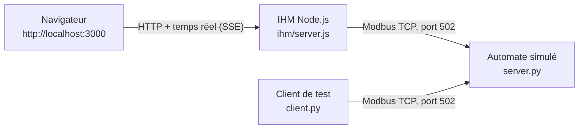

# Ventilation Modbus

Simulation d'un **automate programmable (API)** qui pilote la ventilation d'un
bâtiment, avec une **IHM web** de supervision.

L'automate lit deux capteurs de température (intérieur et extérieur), commande
4 ventilateurs selon une logique été / hiver, et expose toutes ses données en
**Modbus TCP**, comme un vrai automate industriel. L'IHM et le client de test
ne communiquent avec lui que par Modbus.



## Fonctionnement de l'automate

### Les capteurs

| Capteur | Rôle |
|---|---|
| **T_int** | Température intérieure du bâtiment |
| **T_ext** | Température extérieure |

### Les ventilateurs

V1, V2 et V3 soufflent de l'air dans le bâtiment. **V4 est monté à l'envers** :
il extrait l'air du bâtiment, ce qui n'a d'intérêt que s'il fait plus chaud
dedans que dehors.

| Ventilateur | Mode été | Mode hiver |
|---|---|---|
| V1 | T_int ≥ 23 °C | T_int ≥ 26 °C |
| V2 | T_int ≥ 24 °C | T_int ≥ 27 °C |
| V3 | T_int ≥ 25 °C | T_int ≥ 28 °C |
| V4 (extraction) | T_int > T_ext | T_int > T_ext **et** T_int > 28 °C |

En hiver, une **boucle thermohydraulique** chauffe le bâtiment : les seuils
sont plus hauts pour profiter de cette chaleur avant de ventiler, et V4
n'évacue l'air chaud que si l'intérieur dépasse 28 °C.

**Hystérésis de 0,5 °C** : un ventilateur s'arrête 0,5 °C sous son seuil de
démarrage (par exemple V1 démarre à 23 °C et s'arrête sous 22,5 °C). Cela évite
qu'il s'allume et s'éteigne en permanence quand la température oscille autour
du seuil.

### La simulation

Le programme simule aussi la physique du bâtiment, en **temps accéléré** (une
journée dure 10 minutes) :

- **Extérieur** : cycle jour/nuit, entre 18 et 30 °C en été, entre 0 et 10 °C en hiver.
- **Intérieur** : le bâtiment se réchauffe (soleil, occupants et, en hiver, la
  boucle de chauffage). Les échanges par les murs et chaque ventilateur en
  marche rapprochent la température intérieure de la température extérieure.

Pour les tests, les deux températures peuvent être **forcées** à une valeur
choisie depuis l'IHM.

### Cycle automate

Comme un vrai API, le programme tourne en boucle toutes les **0,2 s** :

1. lecture des entrées Modbus (mode été/hiver, forçages) ;
2. calcul : mise à jour des températures, puis de l'état des ventilateurs ;
3. écriture des sorties Modbus (températures, état des ventilateurs).

## Table d'échange Modbus

Automate : unit id **1**, port **502**. Toutes les adresses sont définies à un
seul endroit, [`modbus_map.py`](src/tp_simu_auto/modbus_map.py), que l'automate,
le client et l'IHM utilisent tous.

| Type | Adresse | Accès | Signification |
|---|---|---|---|
| Coil | 0 | lecture/écriture | Mode : 1 = été, 0 = hiver |
| Coil | 1 | lecture/écriture | Forçage de T_int actif |
| Coil | 2 | lecture/écriture | Forçage de T_ext actif |
| Holding register | 0 | lecture/écriture | Valeur forcée de T_int |
| Holding register | 1 | lecture/écriture | Valeur forcée de T_ext |
| Discrete input | 0 à 3 | lecture seule | État de V1 à V4 |
| Input register | 0 | lecture seule | T_int |
| Input register | 1 | lecture seule | T_ext |

Les températures sont transmises en **dixièmes de degré**, en entier signé
16 bits pour accepter les valeurs négatives (23,4 °C → 234).

## Structure du projet

```
├── src/tp_simu_auto/
│   ├── modbus_map.py     # table d'échange Modbus (adresses, échelle)
│   └── automate.py       # logique des ventilateurs et simulation physique
├── server.py             # l'automate : serveur Modbus TCP + cycle de 0,2 s
├── client.py             # client de test automatique (scénario été + hiver)
├── ihm/
│   ├── server.js         # serveur de l'IHM : passerelle Modbus <-> navigateur
│   ├── modbus_map.js     # relit les adresses dans modbus_map.py
│   └── public/index.html # la page de supervision
└── pyproject.toml, uv.lock, ihm/package.json   # dépendances
```

Technologies : **Python 3.13** avec [uv](https://docs.astral.sh/uv/) et
[pymodbus](https://pymodbus.readthedocs.io/) 3.15 pour l'automate ;
**Node.js** avec [modbus-serial](https://www.npmjs.com/package/modbus-serial)
pour l'IHM.

## Tester le projet

**Prérequis** : [uv](https://docs.astral.sh/uv/getting-started/installation/)
et [Node.js](https://nodejs.org/).

**Installation** (une seule fois) :

```bash
git clone https://github.com/chloeturcan1/ventilation-modbus.git
cd ventilation-modbus
uv sync
cd ihm && npm install && cd ..
```

**Terminal 1 — l'automate** (à laisser ouvert) :

```bash
uv run server.py
```

**Terminal 2 — l'IHM** (à laisser ouvert) :

```bash
cd ihm
npm start
```

Ouvre ensuite **http://localhost:3000** dans ton navigateur : températures en
direct, état des 4 ventilateurs, bouton été/hiver et forçage des températures.

**Terminal 3 — test automatique** (facultatif) :

```bash
uv run client.py
```

Le client parcourt tous les seuils été et hiver en forçant les températures, et
vérifie à chaque étape la réaction des ventilateurs. Le test est réussi si
toutes les lignes affichent `OK` et que la dernière indique
`Scenario termine : 0 ecart(s).` Si la page web est ouverte en même temps, on
voit les ventilateurs réagir en direct.

Pour tout arrêter : **Ctrl+C** dans chaque terminal.

> Sous Linux, le port 502 est réservé à l'administrateur : lancer l'automate
> avec `sudo`, ou changer `PORT` dans `modbus_map.py`.
