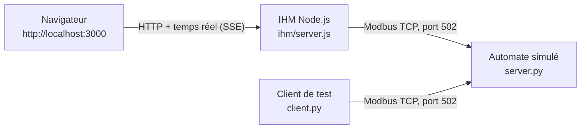

# Ventilation Modbus

Simulation d'un **automate programmable (API)** qui pilote la ventilation d'un
bâtiment, avec une **IHM web** de supervision.

L'automate lit deux capteurs de température (intérieur et extérieur), commande
4 ventilateurs selon une logique été / hiver, gère un mode **auto / manuel**,
des **sécurités** (arrêt d'urgence, contrôle de rotation, défauts capteurs) et
des **alarmes** à acquitter. Il expose toutes ses données en **Modbus TCP**,
comme un vrai automate industriel. L'IHM et le client de test
ne communiquent avec lui que par Modbus.



## Fonctionnement de l'automate

### Les capteurs

| Capteur | Rôle |
|---|---|
| **T_int** | Température intérieure du bâtiment |
| **T_ext** | Température extérieure |

### Les ventilateurs

V1, V2 et V3 soufflent de l'air dans le bâtiment. **V4 est monté à l'envers** :
il extrait l'air du bâtiment, ce qui n'a d'intérêt que s'il fait plus chaud
dedans que dehors.

| Ventilateur | Mode été | Mode hiver |
|---|---|---|
| V1 | T_int ≥ 23 °C | T_int ≥ 26 °C |
| V2 | T_int ≥ 24 °C | T_int ≥ 27 °C |
| V3 | T_int ≥ 25 °C | T_int ≥ 28 °C |
| V4 (extraction) | T_int > T_ext | T_int > T_ext **et** T_int > 28 °C |

En hiver, une **boucle thermohydraulique** chauffe le bâtiment : les seuils
sont plus hauts pour profiter de cette chaleur avant de ventiler, et V4
n'évacue l'air chaud que si l'intérieur dépasse 28 °C.

**Hystérésis de 0,5 °C** : un ventilateur s'arrête 0,5 °C sous son seuil de
démarrage (par exemple V1 démarre à 23 °C et s'arrête sous 22,5 °C). Cela évite
qu'il s'allume et s'éteigne en permanence quand la température oscille autour
du seuil.

### La simulation

Le programme simule aussi la physique du bâtiment, en **temps accéléré** (une
journée dure 10 minutes) :

- **Extérieur** : cycle jour/nuit, entre 18 et 30 °C en été, entre 0 et 10 °C en hiver.
- **Intérieur** : le bâtiment se réchauffe (soleil, occupants et, en hiver, la
  boucle de chauffage). Les échanges par les murs et chaque ventilateur en
  marche rapprochent la température intérieure de la température extérieure.

Pour les tests, les deux températures peuvent être **forcées** à une valeur
choisie depuis l'IHM, et une **panne moteur** peut être simulée sur chaque
ventilateur (il ne tourne plus, même commandé).

### Mode auto / manuel

Chaque ventilateur a son propre mode de conduite, choisi depuis l'IHM :

| Mode | Comportement |
|---|---|
| **Auto** | piloté par la logique été / hiver ci-dessus |
| **Marche** (manuel) | marche forcée par l'opérateur |
| **Arrêt** (manuel) | arrêt forcé par l'opérateur |

La logique automatique continue de tourner en arrière-plan : en revenant en
auto, le ventilateur reprend l'état calculé, hystérésis comprise.

### Sécurités

Elles s'appliquent par ordre de priorité, la première l'emportant sur toutes
les autres, **mode manuel compris** :

1. **Arrêt d'urgence (AU)** : tous les ventilateurs s'arrêtent. Quand on
   relâche le bouton, **rien ne redémarre** tant que l'opérateur n'a pas
   acquitté (réarmement), pour qu'une machine ne reparte jamais toute seule.
2. **Contrôle de rotation** : si un ventilateur est commandé mais qu'aucun
   retour de marche n'arrive pendant **2 s**, il passe en défaut et reste
   verrouillé à l'arrêt jusqu'à l'acquittement.
3. **Mode manuel**, puis **logique automatique**.

**Mode dégradé** : un capteur qui mesure hors de sa plage (−40 à 80 °C) est
considéré en défaut (câble coupé, sonde HS) :

- sans T_int, l'automate ne peut plus appliquer ses seuils : seul **V1** tourne,
  pour garder un renouvellement d'air minimal ;
- sans T_ext, la comparaison intérieur / extérieur est impossible : **V4**
  s'arrête.

### Alarmes

| Alarme | Cause |
|---|---|
| Arrêt d'urgence | bouton AU enfoncé |
| Température intérieure haute | T_int ≥ 35 °C (hystérésis 0,5 °C) |
| Défaut capteur T_int / T_ext | mesure hors de la plage −40 à 80 °C |
| Défaut rotation V1 à V4 | commandé sans retour de marche pendant 2 s |

Chaque alarme est **mémorisée** dès que sa cause apparaît. L'**acquittement**
efface les alarmes mémorisées dont la cause a disparu ; une alarme dont la
cause est toujours présente reste affichée. L'IHM montre un bandeau (rouge :
alarme active, orange : en attente d'acquittement), l'état de chaque alarme et
un **journal horodaté** (apparition, disparition, acquittement).

### Cycle automate

Comme un vrai API, le programme tourne en boucle toutes les **0,2 s** :

1. lecture des entrées Modbus (mode été/hiver, forçages, modes auto/manu,
   arrêt d'urgence, acquittement) ;
2. calcul : températures, alarmes, logique automatique, puis commande des
   ventilateurs après modes et sécurités ;
3. écriture des sorties Modbus (températures, mots d'alarmes, état des
   ventilateurs).

## Table d'échange Modbus

Automate : unit id **1**, port **502**. Toutes les adresses sont définies à un
seul endroit, [`modbus_map.py`](src/tp_simu_auto/modbus_map.py), que l'automate,
le client et l'IHM utilisent tous.

| Type | Adresse | Accès | Signification |
|---|---|---|---|
| Coil | 0 | lecture/écriture | Mode : 1 = été, 0 = hiver |
| Coil | 1 | lecture/écriture | Forçage de T_int actif |
| Coil | 2 | lecture/écriture | Forçage de T_ext actif |
| Coil | 3 | lecture/écriture | Arrêt d'urgence enfoncé |
| Coil | 4 | lecture/écriture | Acquittement : écrire 1, l'automate le remet à 0 |
| Coil | 5 à 8 | lecture/écriture | Panne moteur simulée de V1 à V4 (tests) |
| Holding register | 0 | lecture/écriture | Valeur forcée de T_int |
| Holding register | 1 | lecture/écriture | Valeur forcée de T_ext |
| Holding register | 2 à 5 | lecture/écriture | Mode de V1 à V4 : 0 = auto, 1 = marche, 2 = arrêt |
| Discrete input | 0 à 3 | lecture seule | Retour de marche de V1 à V4 |
| Input register | 0 | lecture seule | T_int |
| Input register | 1 | lecture seule | T_ext |
| Input register | 2 | lecture seule | Mot d'alarmes actives |
| Input register | 3 | lecture seule | Mot d'alarmes mémorisées (à acquitter) |

Les températures sont transmises en **dixièmes de degré**, en entier signé
16 bits pour accepter les valeurs négatives (23,4 °C → 234).

Dans les **mots d'alarmes**, chaque bit correspond à une alarme : bit 0 arrêt
d'urgence, bit 1 température haute, bit 2 défaut capteur T_int, bit 3 défaut
capteur T_ext, bits 4 à 7 défaut rotation V1 à V4. Par exemple, un mot qui vaut
`0x21` signale l'arrêt d'urgence et un défaut de rotation sur V2.

## Structure du projet

```
├── src/tp_simu_auto/
│   ├── modbus_map.py     # table d'échange Modbus (adresses, échelle)
│   └── automate.py       # logique, modes, sécurités, alarmes et simulation physique
├── server.py             # l'automate : serveur Modbus TCP + cycle de 0,2 s
├── client.py             # client de test automatique (seuils, conduite, sécurités)
├── ihm/
│   ├── server.js         # serveur de l'IHM : passerelle Modbus <-> navigateur
│   ├── modbus_map.js     # relit les adresses dans modbus_map.py
│   └── public/index.html # la page de supervision
└── pyproject.toml, uv.lock, ihm/package.json   # dépendances
```

Technologies : **Python 3.13** avec [uv](https://docs.astral.sh/uv/) et
[pymodbus](https://pymodbus.readthedocs.io/) 3.15 pour l'automate ;
**Node.js** avec [modbus-serial](https://www.npmjs.com/package/modbus-serial)
pour l'IHM.

## Tester le projet

**Prérequis** : [uv](https://docs.astral.sh/uv/getting-started/installation/)
et [Node.js](https://nodejs.org/).

**Installation** (une seule fois) :

```bash
git clone https://github.com/chloeturcan1/ventilation-modbus.git
cd ventilation-modbus
uv sync
cd ihm && npm install && cd ..
```

**Tu as déjà le projet sur ton ordinateur ?** Ne refais pas `git clone`, qui
échoue si le dossier existe déjà. Va dans ton dossier existant et récupère
la dernière version :

```bash
cd chemin/vers/ton/dossier
git pull
uv sync
cd ihm && npm install && cd ..
```

Toutes les commandes suivantes se lancent **depuis le dossier du projet**.
Garde un seul exemplaire du projet sur ton ordinateur : avec plusieurs
copies, il est facile de lancer une ancienne version sans s'en rendre compte.

**Terminal 1 — l'automate** (à laisser ouvert) :

```bash
uv run server.py
```

**Terminal 2 — l'IHM** (à laisser ouvert) :

```bash
cd ihm
npm start
```

Ouvre ensuite **http://localhost:3000** dans ton navigateur : températures en
direct, état des 4 ventilateurs avec leur mode auto / marche / arrêt, bouton
été/hiver, arrêt d'urgence, alarmes et journal, forçage des températures et
simulation de pannes.

**Terminal 3 — test automatique** (facultatif) :

```bash
uv run client.py
```

Le client parcourt tous les seuils été et hiver en forçant les températures,
puis teste la conduite et les sécurités : modes manuels, arrêt d'urgence et
réarmement, panne d'un ventilateur, capteurs hors plage, alarme haute. À chaque
étape, il vérifie la réaction des ventilateurs et les mots d'alarmes (colonne
`AL=actives/mémorisées`, en hexadécimal). Le test est réussi si
toutes les lignes affichent `OK` et que la dernière indique
`Scenario termine : 0 ecart(s).` Si la page web est ouverte en même temps, on
voit les ventilateurs réagir en direct.

Pour tout arrêter : **Ctrl+C** dans chaque terminal.

### Problèmes fréquents

- **`destination path 'ventilation-modbus' already exists`** : le projet est
  déjà sur ton ordinateur. Utilise la procédure « Tu as déjà le projet » plus
  haut au lieu de `git clone`.
- **`address already in use`**, ou la page affiche une **ancienne version** :
  une automate ou une IHM tourne déjà, peut-être lancée depuis un autre
  dossier ou un autre terminal. Sur macOS ou Linux, arrête-les puis relance :

  ```bash
  lsof -ti tcp:502,3000 | xargs kill
  ```

  Recharge ensuite la page en vidant le cache (**Cmd+Shift+R** sur Mac,
  **Ctrl+Shift+R** sous Windows et Linux).

> Sous Linux, le port 502 est réservé à l'administrateur : lancer l'automate
> avec `sudo`, ou changer `PORT` dans `modbus_map.py`.

### Projet dans un dossier synchronisé iCloud (macOS)

Si `uv run server.py` affiche `ModuleNotFoundError: No module named
'tp_simu_auto'` alors que le projet est dans Documents ou Bureau synchronisés
avec iCloud, c'est qu'iCloud marque comme « cachés » les fichiers `.pth` de
l'environnement virtuel, que Python 3.13 ignore alors. La solution est de
placer l'environnement dans un dossier `.nosync`, qu'iCloud ne synchronise pas :

```bash
rm -rf .venv
mkdir .venv.nosync
ln -s .venv.nosync .venv
uv sync
```
